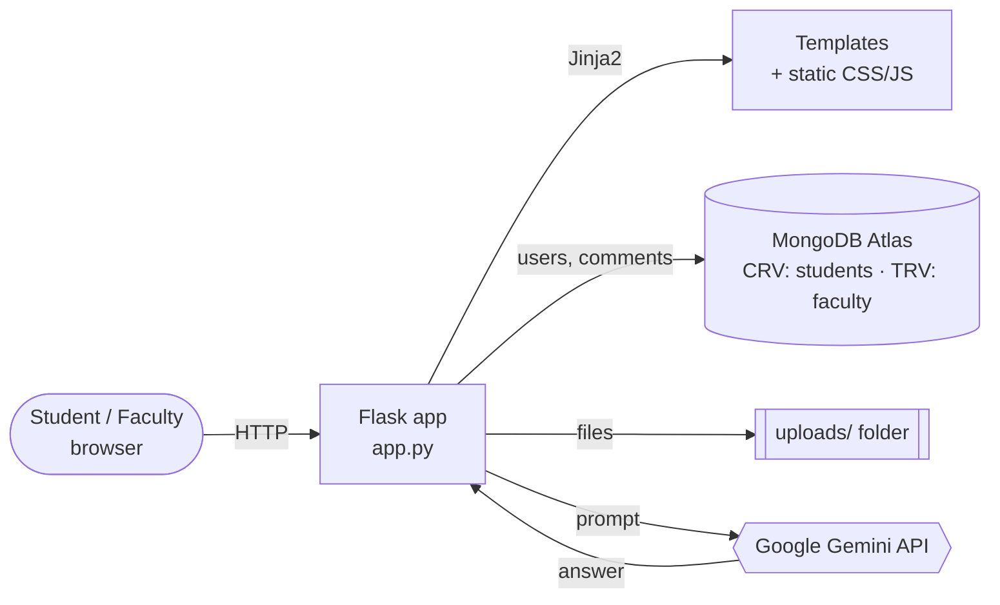

<div align="center">


# IgniteXT

**An e-learning platform where faculty share knowledge and students learn faster, with an AI study assistant built in.**

[](https://www.python.org/)
[](https://flask.palletsprojects.com/)
[](https://www.mongodb.com/atlas)
[](https://ai.google.dev/)
[](https://render.com/deploy?repo=https://github.com/shiva-1301/IgniteXT_E_Learning_Management_System)

[Live demo](#-deployment) · [Features](#-features) · [Quick start](#-quick-start) · [Report a bug](https://github.com/shiva-1301/IgniteXT_E_Learning_Management_System/issues)

</div>

---

## 📖 About

Course material is often spread across email threads, chat groups and shared drives. **IgniteXT** puts it in one place:

- **Faculty** upload notes, slides and lecture files, and moderate discussions.
- **Students** watch video courses, download materials, follow career roadmaps and comment on lessons.
- **Everyone** can ask the **AI assistant** (Google Gemini) a question and get an answer straight away.

> 🎓 I built this as a first-year college project, then redesigned and hardened it with a modern UI, secure configuration and a production deployment setup.

## 📸 Screenshots

| Sign in | Home |
|:---:|:---:|
|  |  |
| **Video & comments** | **AI assistant** |
|  |  |

<sub>To add screenshots, save them in <code>docs/screenshots/</code> using the file names above.</sub>

## ✨ Features

### For students
- 🎓 **Course catalogue** with playlists and an in-browser video player
- 🔎 **Instant search** that filters courses, roadmaps and files as you type
- 🗺️ **25 developer roadmaps** (Frontend, Backend, DevOps, AI Engineer, Python, Java, Cyber Security and more)
- 📁 **Study materials** you can download in one click
- 💬 **Lesson comments** for asking questions and discussing lessons
- 🤖 **AI study assistant** with suggested prompts, a typing indicator and formatted answers

### For faculty
- ☁️ **Drag-and-drop uploads** with a file-size check before upload
- 🛡️ **Comment moderation** to remove inappropriate comments
- 📊 **Dashboard** with quick actions

### Across the whole app
- 🌗 **Light and dark themes** (your choice is remembered)
- 📱 **Fully responsive** on mobile, tablet and desktop
- ♿ **Accessible**: semantic HTML, form labels, keyboard navigation, ARIA attributes, reduced-motion support
- 🔐 **Secure by default**: bcrypt password hashing, login-protected routes, upload type and size limits, escaped AI output, secrets kept in environment variables

## 👥 Roles at a glance

| Capability | Student | Faculty |
|---|:---:|:---:|
| Browse courses, playlists and videos | ✅ | ✅ |
| View developer roadmaps | ✅ | ✅ |
| Download study materials | ✅ | ✅ |
| Comment on lessons | ✅ | ✅ |
| Use the AI assistant | ✅ | ✅ |
| Upload study materials | — | ✅ |
| Delete comments | — | ✅ |

## 🛠 Tech stack

| Layer | Technology |
|---|---|
| Backend | Python, Flask, Flask-Bcrypt, Gunicorn |
| Database | MongoDB Atlas via PyMongo |
| AI | Google Gemini (`google-generativeai`) |
| Frontend | Jinja2 templates, custom CSS design system, vanilla JavaScript |
| UI assets | Inter font, Font Awesome icons |
| Hosting | Render |

## 🏗 Architecture



## 🚀 Quick start

### Prerequisites
- **Python 3.10+**
- A **MongoDB** database (a free [Atlas](https://www.mongodb.com/atlas) cluster or a local `mongod`)
- *(Optional)* a **[Gemini API key](https://aistudio.google.com/app/apikey)** to turn on the AI assistant

### 1. Clone and install

```bash
git clone https://github.com/shiva-1301/IgniteXT_E_Learning_Management_System.git
cd IgniteXT_E_Learning_Management_System

python -m venv venv
venv\Scripts\activate          # Windows
# source venv/bin/activate     # macOS / Linux

pip install -r requirements.txt
```

### 2. Configure

```bash
cp .env.example .env           # Windows: copy .env.example .env
```

Open `.env` and fill in your values:

| Variable | Required | Description |
|---|:---:|---|
| `MONGODB_URI` | ✅ | MongoDB connection string |
| `SECRET_KEY` | ✅ *(prod)* | Signs session cookies. Generate one with `python -c "import secrets; print(secrets.token_hex(32))"` |
| `GEMINI_API_KEY` | — | Enables the AI assistant. Without it, the assistant page shows a "not configured" notice |
| `GEMINI_MODEL` | — | Gemini model name. Default: `gemini-2.0-flash` |
| `FLASK_DEBUG` | — | Set to `1` for auto-reload and debug pages while developing |
| `MAX_UPLOAD_MB` | — | Maximum upload size. Default: `50` |

### 3. Run

```bash
python app.py
```

Open **http://127.0.0.1:5000** in your browser.

> 💡 **Try both roles:** register once as **Faculty** (to upload files and moderate comments) and once as **Student**.

## 🗂 Project structure

```
IgniteXT/
├── app.py                # Routes, auth, uploads, comments, chatbot API
├── config.py             # Loads settings from environment / .env
├── requirements.txt
├── render.yaml           # Render blueprint (one-click deploy)
├── Procfile              # Start command for Heroku-style hosts
├── .env.example          # Template for your local .env
├── static/
│   ├── css/main.css      # Design tokens, components, themes, breakpoints
│   ├── js/main.js        # Theme toggle, sidebar, menus, live search
│   ├── images/           # Logo, thumbnails, avatars, demo videos
│   └── roadmaps/         # Developer roadmap PDFs
└── templates/
    ├── base.html         # HTML skeleton
    ├── layout.html       # App shell: header, sidebar, footer
    ├── _macros.html      # Reusable pieces: flash messages, course card
    ├── auth.html         # Sign in / sign up
    ├── home.html  courses.html  playlist.html  watch-video.html
    ├── dashboard.html  road.html  chatbot.html
    ├── upload.html  download.html
    └── error.html        # 403 / 404 / 500 page
```

<details>
<summary><b>🧭 Routes reference</b></summary>

| Route | Method | Access | Purpose |
|---|---|---|---|
| `/auth` | GET, POST | Public | Sign in and register |
| `/logout` | GET | Public | End the session |
| `/home` | GET | Logged in | Landing page |
| `/courses` | GET | Logged in | Course catalogue |
| `/playlist` | GET | Logged in | Playlist details |
| `/video` | GET, POST | Logged in | Video player; POST adds a comment |
| `/delete_comment/<id>` | POST | Faculty | Delete a comment |
| `/roadmap` | GET | Logged in | Developer roadmaps |
| `/download` | GET | Logged in | List study materials |
| `/download/<file>` | GET | Logged in | Download a file |
| `/upload` | GET, POST | Faculty | Upload a file |
| `/dashboard` | GET | Logged in | Profile and activity |
| `/dashboard/chatbot` | GET | Logged in | AI assistant page |
| `/dashboard/generate-response` | POST | Logged in | Chatbot API (returns JSON) |

</details>

## ☁️ Deployment

IgniteXT includes a [`render.yaml`](render.yaml) blueprint for the **free tier on [Render](https://render.com)**.

1. **Push** this repository to GitHub.
2. **Open your database to Render:** in MongoDB Atlas, go to **Network Access → Add IP → `0.0.0.0/0`** (Render uses changing IP addresses).
3. **Create the service:** on Render, click **New → Blueprint** and select this repository.
4. **Add secrets:** enter `MONGODB_URI` and `GEMINI_API_KEY` when Render asks. `SECRET_KEY` is generated for you.
5. **Deploy.** The app goes live at a URL like `https://ignitext.onrender.com`.

> ⚠️ **Uploads on the free tier are temporary.** Render's free filesystem is wiped on every restart or redeploy. To keep uploaded files, attach a [Render Disk](https://render.com/docs/disks) mounted at `/opt/render/project/src/uploads`, or store uploads in S3, Cloudinary or MongoDB GridFS.

> 💤 Free Render services sleep after about 15 minutes without traffic, so the first request after that can take around 30 seconds.

## 🧰 Troubleshooting

| Problem | Fix |
|---|---|
| `ServerSelectionTimeoutError` | Check `MONGODB_URI` and confirm your IP is allowed in Atlas **Network Access**. |
| Assistant says "not configured" | Set `GEMINI_API_KEY` in `.env` (locally) or in Render's environment settings, then restart. |
| Assistant returns an error | The model in `GEMINI_MODEL` may be retired, or your API quota may be used up. Try another model. |
| You're logged out after every restart | Set a fixed `SECRET_KEY`. Without one, a random key is generated on each start. |
| "File is too large" | Raise `MAX_UPLOAD_MB`. |

## 🗺 Roadmap

- [ ] Store courses, playlists and videos in MongoDB so faculty can create them from the UI
- [ ] Real likes, saved playlists and progress tracking
- [ ] CSRF protection (Flask-WTF) and rate limiting on login
- [ ] Password reset by email
- [ ] Persistent cloud storage for uploads
- [ ] Automated tests and a CI workflow

## 🤝 Contributing

Contributions are welcome:

1. Fork the repository.
2. Create a branch: `git checkout -b feature/amazing-feature`.
3. Commit your changes: `git commit -m "Add amazing feature"`.
4. Push the branch and open a pull request.

Please never commit real credentials. Keep them in `.env`, which git ignores.

## 📄 License

This is an educational project. Roadmap PDFs are courtesy of [roadmap.sh](https://roadmap.sh).

<div align="center">

Made with 🔥 by <a href="https://github.com/shiva-1301">Shiva</a> · If this project helped you, consider giving it a ⭐

</div>
